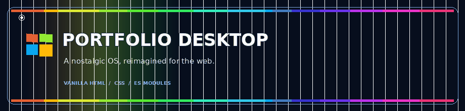
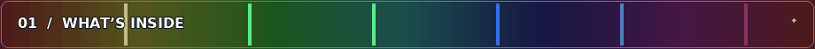
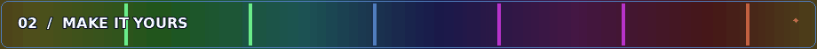
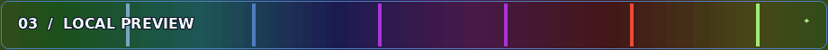
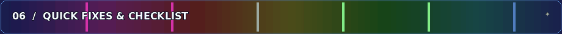

<div align="center">
  
  <br>
  <h1>Portfolio Desktop</h1>
  <p><strong>A tiny portfolio inside a familiar desktop.</strong><br>Boot up, open a window, and explore.</p>
  <p>
    
    
    
    
  </p>
  <p><em>Static site · Mobile-friendly · GitHub Pages-ready</em></p>
</div>

---

> **Template note:** The profile and projects are sample content. Replace them with your own before publishing. The Windows-style desktop is an unofficial, nostalgia-inspired portfolio interface and is not affiliated with Microsoft.

## Reference design study

The supplied portfolio is not a conventional scrolling landing page: it presents itself as a small operating-system simulation. Its experience is organized as **boot → user log-on → desktop → app windows**, with portfolio pages living inside the desktop shell. The details that make the reference recognizable are its Luna-blue chrome, green Start button, hill-and-sky wallpaper, left-side shortcuts, Start menu, taskbar/tray, draggable windows, context menus, and CRT-style screen treatment.

The reference’s public page uses plain HTML and CSS with JavaScript ES modules; its browser source loads a self-hosted XP-style CSS sheet alongside custom scripts. This template follows that technology choice—no framework or runtime dependencies—and recreates the same broad information architecture and interaction patterns with an independent window manager, its own CSS, a different profile, and original wallpaper/project illustrations. The reference’s own program-specific content and artwork are not bundled here.



## What’s inside

A complete portfolio shell, built with the same kind of lightweight stack as the reference: **vanilla HTML, CSS, and JavaScript ES modules**. There is no framework, build step, package installation, or runtime dependency. The XP-style chrome is written in `src/styles/xp.css` and `src/styles/main.css`.

- **Boot and log-on:** a short animated startup, a custom log-on screen, and a desktop profile tile.
- **Desktop shell:** original meadow wallpaper, draggable shortcuts, right-click context menu, Start menu, All Programs, quick-launch icons, taskbar, system tray, clock, and calendar.
- **Window manager:** open, focus, drag, resize, minimize, maximize, restore, and close app windows. Double-click a title bar to maximize it. Use **F11** or the tray control for full screen.
- **Portfolio programs:** About Me, My Projects with case-study detail views, Resume with print-to-PDF, Contact Me, and a small portfolio browser.
- **Extra programs:** My Computer, Paint canvas, Notepad with local save, Calculator, Command Prompt, display settings, Help, Image Viewer, a local Messenger demo, a tiny handheld, Minesweeper, and a mini pinball table.
- **Polish:** custom SVG iconography, a custom pointer, optional CRT/scanline overlay, subtle system tones, hover states, responsive phone layout, and reduced-motion support.
- **Original artwork:** a newly generated desktop wallpaper and hand-authored SVG project covers. No images are loaded from the reference site.

The Contact form uses a `mailto:` link: it opens the visitor’s configured email app and **does not** send through a server. The Messenger replies locally and does not store or transmit messages.



## Make it yours

### 1. Edit your profile

Open **`src/scripts/config.js`** and replace the sample values in `PROFILE`:

- `name`, `initials`, `role`, `location`, and `availability`
- `email`, `website`, and the Instagram / LinkedIn / GitHub URLs
- `about`, `specialties`, `skills`, `experience`, and `education`

The log-on tile, Start menu, About window, Resume window, and page title use this configuration. Keep the email address real if you want the Contact form to open the right recipient.

### 2. Replace the sample work

In the same file, edit the `PROJECTS` array. Each project has a short `id`, `title`, `category`, `year`, local SVG `image`, alt text, and case-study description. Replace the four SVGs in **`src/assets/projects/`** with your own artwork, or update the `image` paths to point to new files.

### 3. Change the look

- **Wallpaper:** replace `src/assets/wallpaper.jpg` with a 16:9 image of your own, keeping the same filename; or update the background path in `src/styles/main.css`.
- **Palette, cursors, layout, and motion:** edit `src/styles/main.css`.
- **Raised controls and desktop chrome:** edit `src/styles/xp.css`.
- **App copy and interactions:** `src/scripts/apps.js`, `src/scripts/main.js`, and `src/scripts/games.js`.
- **Icons:** `src/scripts/icons.js`.
- **Page title / social preview text:** the `<head>` section of `index.html`.

The starter avatar is a simple vector illustration, not a real portrait. Replace `src/assets/avatar.svg` with your own image or update the avatar markup; add useful alt text if the image conveys information. Before publishing, replace the `[Your Name]` placeholder in `LICENSE`.



## See the preview

Because this site uses JavaScript ES modules, serve the folder over HTTP rather than opening `index.html` directly with `file://`.

### Easiest: Python’s built-in server

1. Download or unzip the project.
2. Open a terminal **inside the project root** (the folder containing `index.html`).
3. Run one of these commands:

   **Windows**

   ```bash
   py -m http.server 8000
   ```

   If `py` is not installed, try:

   ```bash
   python -m http.server 8000
   ```

   **macOS / Linux**

   ```bash
   python3 -m http.server 8000
   ```

4. Open **[http://localhost:8000](http://localhost:8000)** in your browser.
5. Stop the local server with **Ctrl+C** in the terminal.



## Quick troubleshooting

- **Blank page or module error:** start the local HTTP server from the project root. Do not double-click `index.html` to preview ES modules.
- **GitHub Pages shows a 404:** confirm `index.html` is at the top level of the selected source (`main` → `/(root)`) and that Pages has finished deploying.
- **Wallpaper or project art is missing:** paths and filenames are case-sensitive on GitHub Pages. Check that `src/assets/wallpaper.jpg` and all referenced project SVGs were uploaded.
- **Contact does not send online:** expected. It opens a local email app using `mailto:`. To send messages directly from a site, connect a form service or your own backend and review its privacy settings.
- **The full-screen button is blocked:** browsers require a user click and may restrict full screen inside embedded previews; try **F11** in a normal browser tab.

## Repository map

```text
portfolio-template/
├── index.html                    # page shell and boot/log-on screens
├── README.md                     # this animated, sectioned guide
├── .gitignore                    # editor / OS / local build exclusions
├── .nojekyll                     # publish static files as-is on Pages
├── LICENSE                       # MIT starter license
├── favicon.svg
├── docs/media/                   # animated GIF banners for this README
└── src/
    ├── assets/
    │   ├── avatar.svg
    │   ├── wallpaper.jpg
    │   └── projects/*.svg
    ├── scripts/
    │   ├── config.js             # edit profile and work here
    │   ├── icons.js              # inline SVG icon set
    │   ├── apps.js               # portfolio and utility windows
    │   ├── desktop.js            # window manager
    │   ├── games.js              # Minesweeper logic
    │   ├── sound.js              # tiny Web Audio system tones
    │   └── main.js               # boot, menus, and UI events
    └── styles/
        ├── xp.css                # raised controls and base chrome
        └── main.css              # desktop layout, apps, and responsive rules
```


<div align="center">
  <p><strong>Made for curious people and their slightly nostalgic portfolios.</strong></p>
  <p><sub>Windows and Windows XP are trademarks of Microsoft Corporation. This independent portfolio template is an unofficial visual homage, not a Microsoft product.</sub></p>
</div>

---

<div align="center">
## 🌟 Support the Project

If you find this template useful, please consider giving it a star! It helps others discover the repository and supports future development.

## </div>
